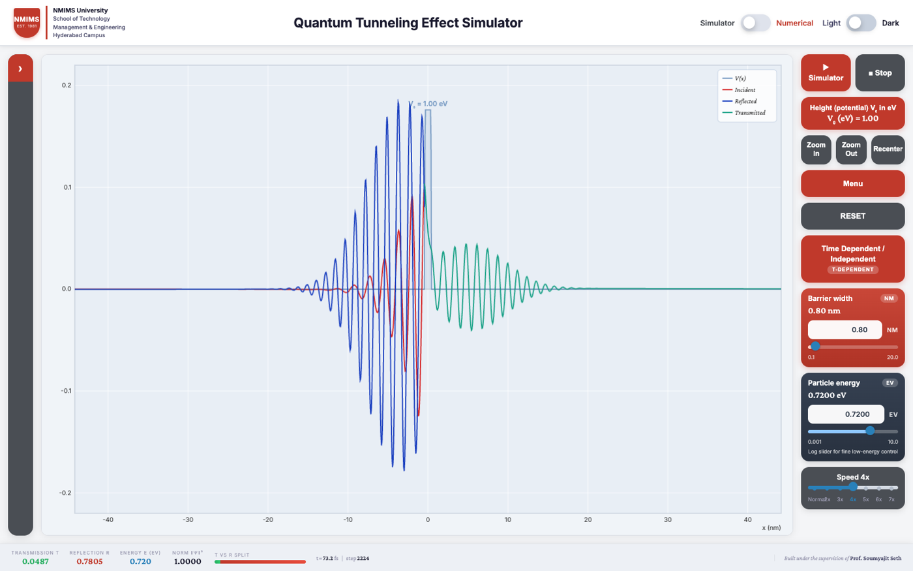
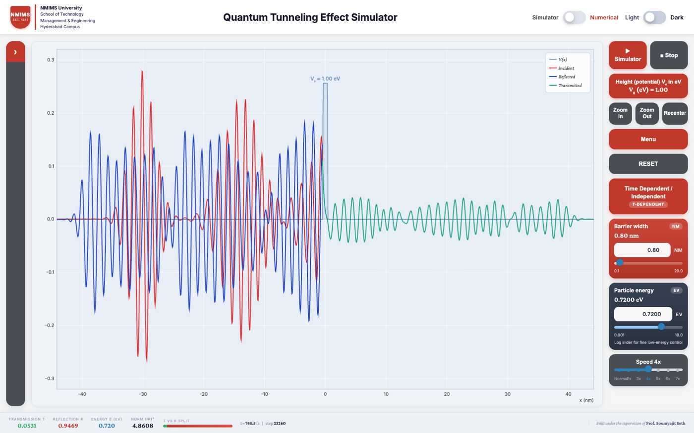
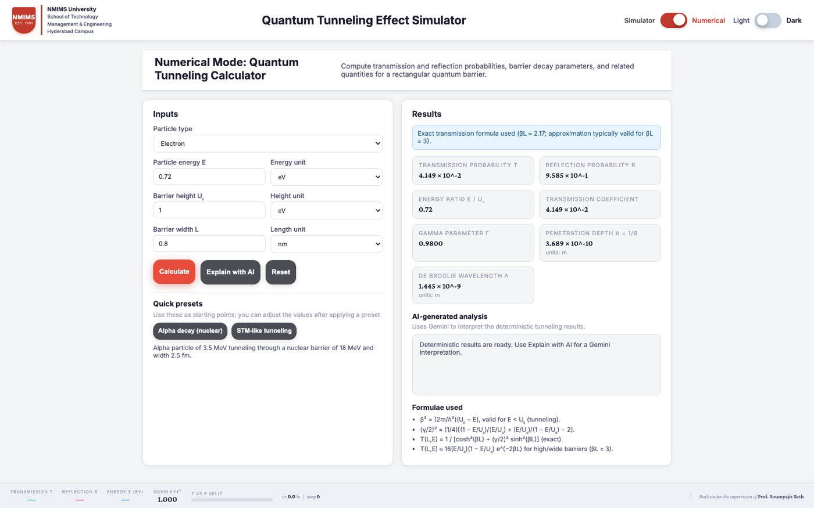
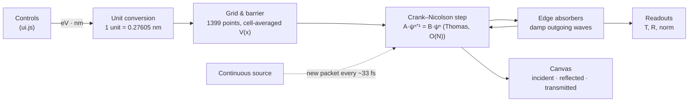

<div align="center">

# ⚛️ Quantum Tunneling Effect Simulator

**Watch an electron's wavefunction hit a potential barrier and partly pass through it, in real time, in your browser.**

A browser-based solver for the 1D time-dependent Schrödinger equation (Crank–Nicolson), with a companion calculator for exact transmission probabilities and optional AI explanations.

[](https://tunnelling-simulator-testing.vercel.app/)




<sub>Default run: a 0.72 eV electron meets a 1.00 eV, 0.8 nm barrier. About 5% of it tunnels through (teal); the rest reflects (blue).</sub>

[Try it](#-try-it-in-60-seconds) · [Experiments](#-experiments-to-try) · [Continuous source](#-continuous-source-packet-train) · [Numerical Mode](#-numerical-mode) · [How it works](#-how-it-works) · [Run locally](#-run-locally)

</div>

---

## ✨ Highlights

|                              |                                                                                                                                                                                                        |
| ---------------------------- | ------------------------------------------------------------------------------------------------------------------------------------------------------------------------------------------------------ |
| 🌊 **Live wave scattering**  | The wavefunction is split into **incident** (red), **reflected** (blue) and **transmitted** (teal) parts, so you can see what tunnels and what bounces back.                                           |
| 📏 **Real electron units**   | Energies in **eV**, lengths in **nm**, time in **fs**. The simulator and Numerical Mode use the same physics, so their results can be compared directly.                                               |
| 🎯 **Honest T / R readouts** | Transmission and reflection are measured relative to the barrier, so the incoming packet never counts as "reflected". With the defaults the result is within 3% of the exact quantum-mechanical value. |
| 🔁 **Continuous source**     | Fires a steady train of identical wavepackets and reports the steady-state T/R.                                                                                                                        |
| 🧮 **Numerical Mode**        | Exact and approximate (high/wide barrier) transmission for electrons, protons, neutrons and alpha particles, with ready-made presets.                                                                  |
| 🤖 **Explain with AI**       | Optional Gemini-powered explanation of a Numerical Mode result. The numbers themselves are always computed in your browser.                                                                            |
| 🌗 **Light / dark theme**    | Toggle in the header; your choice is remembered.                                                                                                                                                       |

---

## 🚀 Try it in 60 seconds

Open the **[live simulator](https://tunnelling-simulator-testing.vercel.app/)** and work through this checklist:

- [ ] **Watch the default run.** A packet leaves −33 nm, hits the barrier at 0 and splits. When it's done, the footer shows **T ≈ 0.052** and **R ≈ 0.948**.
- [ ] **Make the barrier thinner.** Set _Barrier width_ to `0.4` nm and press **RESET**. T jumps to about **0.32**.
- [ ] **Go over the barrier.** Set _Particle energy_ to `1.5` eV (above V₀ = 1 eV). Now most of it passes: T ≈ **0.89**.
- [ ] **Turn on the continuous source.** Click **Time Dependent / Independent**, tick _Enable continuous source_, then **Apply**, and watch the stream of packets.
- [ ] **Check against theory.** Flip the header toggle to **Numerical** and run the same electron (0.72 eV, 1 eV, 0.8 nm). You get T = 0.0415; the [FAQ](#-faq) explains why it differs from 0.052.

<details>
<summary><b>🎛️ What every control does</b> (click to expand)</summary>

| Control                           | What it does                                                                                                                                                           |
| --------------------------------- | ---------------------------------------------------------------------------------------------------------------------------------------------------------------------- |
| **▶ Simulator / ■ Stop**          | Run or pause the time evolution.                                                                                                                                       |
| **Height (potential) V₀**         | Barrier height in eV (0.1–10).                                                                                                                                         |
| **Barrier width**                 | Slider and input, 0.1–20 nm (default 0.8 nm).                                                                                                                          |
| **Particle energy**               | Log slider and input, 0.001–10 eV (default 0.72 eV).                                                                                                                   |
| **Speed**                         | Solver steps per frame (Normal to 7×). The time step itself never changes, so accuracy is the same at every speed.                                                     |
| **Zoom In / Zoom Out / Recenter** | Change the visible x-range only; the physics is untouched.                                                                                                             |
| **Menu**                          | Barrier type (single, double, step, delta-like, free particle), width, energy, packet spread σ (0.5–3 nm) and speed.                                                   |
| **Time Dependent / Independent**  | Run the evolution, or freeze it as a snapshot. Also holds the **Show layers** toggles (incident, reflected, transmitted, \|ψ\|²) and the **continuous source** switch. |
| **RESET**                         | Restart from a fresh packet using the current settings.                                                                                                                |
| **Side drawer (›)**               | _Info_, _Equation used_ and _Working Process_ panels explaining the physics.                                                                                           |

**Footer readouts:** Transmission T · Reflection R · Energy E (eV) · Norm ‖ψ‖² · T-vs-R bar · elapsed time (fs) and step count.

</details>

---

## 🧪 Experiments to try

All values below come from the simulator's own engine with the default packet (σ = 1.38 nm) and, unless stated, V₀ = 1 eV and E = 0.72 eV. Press **RESET** after changing a setting.

|  #  | Setup                            |   T    |   R    | What to notice                                                                                                                |
| :-: | -------------------------------- | :----: | :----: | ----------------------------------------------------------------------------------------------------------------------------- |
|  1  | **Default**: 0.8 nm barrier      | 0.052  | 0.948  | Genuine tunneling: E < V₀, yet about 5% gets through.                                                                         |
|  2  | Width **0.4 nm**                 | 0.324  | 0.676  | Halving the width multiplies T by about 6. Tunneling is extremely sensitive to width.                                         |
|  3  | Width **1.5 nm**                 | 0.0063 | 0.994  | Nearly opaque.                                                                                                                |
|  4  | Width **3 nm**                   | 0.0050 | 0.995  | T barely falls any more. What's left is the packet's high-energy tail going _over_ the barrier, not tunneling ([FAQ](#-faq)). |
|  5  | Energy **0.3 eV**                | 0.0041 | 0.996  | Lower energy means a deeper barrier to tunnel through, so far less gets through.                                              |
|  6  | Energy **1.5 eV**                | 0.890  | 0.110  | Above the barrier, yet 11% still reflects. A classical particle would never bounce back.                                      |
|  7  | Height **2 eV**                  | 0.0004 | 0.9996 | A taller barrier shuts tunneling down exponentially.                                                                          |
|  8  | **Potential step**, V₀ = 0.5 eV  | 0.870  | 0.130  | Partial reflection off a step the particle has enough energy to climb (exact value 0.872).                                    |
|  9  | **Double barrier**, 0.4 nm walls | 0.195  | 0.805  | Some probability rings back and forth between the walls before leaking out.                                                   |
| 10  | **Delta-like** spike             | 0.516  | 0.484  | A very thin, tall barrier (5·V₀ high, ~0.13 nm wide).                                                                         |

> [!TIP]
> Open **Time Dependent / Independent → Show layers → Probability density |ψ|²** to overlay the probability density. You can also hide the incident, reflected or transmitted curves there.

---

## 🔁 Continuous source (packet train)



Enable it under **Time Dependent / Independent → Enable continuous source → Apply**:

- 📤 A fresh copy of the default packet starts at **x = −33 nm** about every **33 fs**. Successive packets are about 16.6 nm apart and move right at about 0.5 nm/fs.
- ↔️ Reflected packets travel back through the incoming ones without disturbing them, because waves superpose.
- 📊 **T/R show "—"** until about half a packet has finished scattering, then settle on the steady-state split (≈ 0.053 at the defaults, matching a single packet).
- 🔄 Changing energy, width or height, or pressing RESET, starts the train again from an empty box so that two different experiments never mix in one reading.
- ℹ️ **Norm** now shows how much probability is in the box, so it can exceed 1 (roughly one per packet in flight).

---

## 🧮 Numerical Mode



Switch with the **Simulator / Numerical** toggle in the header. It computes, for a rectangular barrier:

- **T and R**, plus E/U₀, the Γ parameter, penetration depth δ = 1/β and the de Broglie wavelength λ.
- **Particles:** electron, proton, neutron, alpha (He-4).
- **Units:** eV, keV, MeV or J for energy; fm, pm, nm, Å or m for length.
- **Formula choice:** the exact formula, or the high/wide-barrier approximation when βL ≥ 3 (the result panel says which one was used).

**Presets:** _Alpha decay_ (3.5 MeV alpha through an 18 MeV, 2.5 fm nuclear barrier) and _STM-like tunneling_ (1 eV electron through a 4 eV, 0.8 nm gap).

<details>
<summary><b>📐 Formulae used</b></summary>

$$\beta^2 = \frac{2m}{\hbar^2}(U_0 - E)$$

$$T(L,E) = \frac{1}{\cosh^2(\beta L) + (\gamma/2)^2 \sinh^2(\beta L)} \qquad \text{(exact)}$$

$$T(L,E) \approx 16\,\frac{E}{U_0}\left(1-\frac{E}{U_0}\right) e^{-2\beta L} \qquad (\beta L \ge 3)$$

</details>

**🤖 Explain with AI:** after **Calculate**, this sends the computed numbers (never your key) to a serverless function, [`api/explain.js`](api/explain.js). That function asks Google Gemini for a short plain-language interpretation: summary, regime, meaning and a practical note. See **Deploying** below for setup.

---

## 🔬 How it works



Every animation frame runs `stepsPerFrame` solver steps (`dt` = 0.05, about 0.033 fs), then redraws.

<details>
<summary><b>1 · The equation</b></summary>

The solver evolves the 1D time-dependent Schrödinger equation

$$i\hbar\,\frac{\partial\psi}{\partial t} = \left(-\frac{\hbar^2}{2m}\frac{\partial^2}{\partial x^2} + V(x)\right)\psi$$

in units where ħ = m = 1, on x ∈ [−160, 160]. For an electron with energies in eV, one length unit is ħ/√(mₑ·eV) = **0.27605 nm** and one time unit is ħ/eV = **0.65821 fs**. The domain is therefore about ±44 nm.

</details>

<details>
<summary><b>2 · Crank–Nicolson time stepping</b></summary>

Each step solves

$$\left(I + \tfrac{i\,\Delta t}{2\hbar}H\right)\psi^{n+1} = \left(I - \tfrac{i\,\Delta t}{2\hbar}H\right)\psi^{n}$$

with H discretised by central differences, which gives a tridiagonal matrix. The system is solved in O(N) with the Thomas algorithm. The scheme is unconditionally stable and **unitary**, so there is no renormalisation step: probability only leaves the box through the absorbing edges.

</details>

<details>
<summary><b>3 · Grid and barrier</b></summary>

- **Grid:** 1399 points, dx ≈ 0.229 units (≈ 0.063 nm), about 23 points per wavelength at the default energy.
- **Barrier edges:** cell-averaged. Each grid point receives V₀ times the fraction of its cell that lies inside the barrier, so the discrete barrier has exactly the width you set rather than snapping to whole grid cells.
- **Energy cap:** energies are limited to 10 eV. Above that the wavelength gets too short for the grid to resolve.

</details>

<details>
<summary><b>4 · Absorbing edges</b></summary>

The outer 24 units (~6.6 nm) at each end damp ψ smoothly, with a factor of exp(−γ·dt·s²), where γ = 1.5 and s runs from 0 to 1 across the band. Probability removed there is booked as transmitted (right edge) or reflected (left edge). A test packet loses more than 99.8% in the band and fewer than 1 part in 10⁴ bounces back.

</details>

<details>
<summary><b>5 · How T and R are measured</b></summary>

- **T** = |ψ|² beyond the barrier's right edge, plus what the right absorber has taken.
- **R** = the **left-moving** part of ψ (found with an FFT) before the barrier, plus what the left absorber has taken.

The incoming packet moves right, so it never counts towards R. At low energy a Gaussian packet contains a little left-moving content from the very start. That share is measured once and removed, so R only counts genuine reflection.

- **Single packet:** T and R grow from 0 to their final values as the packet scatters.
- **Packet train:** the steady split T/(T+R).

Full details are in [`SIMULATION_LOGIC.md`](SIMULATION_LOGIC.md).

</details>

### ✅ Accuracy

| Check                               |    Simulator    |   Exact   | Error |
| ----------------------------------- | :-------------: | :-------: | :---: |
| Default barrier (packet-averaged T) |     0.0521      |  0.0536   | −2.8% |
| Potential step, V₀ = 0.5 eV         |      0.870      |   0.872   | −0.2% |
| Norm while scattering               | never increases | (unitary) |   —   |

These checks and 47 more run with `npm test`.

---

## 💻 Run locally

No build step is needed to run the app. It is plain HTML, CSS and JS modules.

```bash
git clone https://github.com/anandsharmacy/tunnelling_simulator_testing.git
cd tunnelling_simulator_testing
python3 -m http.server 8000      # any static server works
```

Then open **http://localhost:8000** (simulator) or **http://localhost:8000/numerical-mode.html**.

> [!NOTE]
> A static server can't run the `/api/explain` serverless function, so **Explain with AI** only works when deployed (or under `vercel dev`). Everything else works offline.

<details>
<summary><b>🛠️ Developer commands</b></summary>

```bash
npm install          # dev tooling only (Vitest, ESLint, Prettier, Tailwind)
npm test             # 50 tests: physics, units, readout, packet train, UI sync
npm run lint         # ESLint
npm run format       # Prettier
npm run build:css    # rebuild css/tailwind.css from src/styles/tailwind.css
npm run watch:css    # same, in watch mode
```

The tests drive the real engine headlessly, with no browser and no mocks; see [`js/utils/test-helpers.js`](js/utils/test-helpers.js).

</details>

<details>
<summary><b>📁 Project structure</b></summary>

```text
├── index.html                 # Simulator page (canvas, controls, info drawer)
├── numerical-mode.html        # Numerical Mode calculator page
├── components/                # Shared header & footer (loaded at runtime)
├── css/                       # styles.css, components.css, numerical-mode.css, tailwind.css
├── js/
│   ├── utils/simulation.js    # Physics engine: grid, CN solver, absorber, T/R, packet train, drawing
│   ├── utils/ui.js            # Event wiring, sliders, modals
│   ├── numerical-mode.js      # Analytic calculator + "Explain with AI" client
│   ├── mode-toggle.js         # Simulator ⇄ Numerical switch
│   ├── theme-toggle.js        # Light / dark theme (persisted)
│   └── utils/*.test.js        # Vitest suites
├── api/explain.js             # Vercel serverless function → Google Gemini
├── docs/                      # Screenshots and implementation plans
├── SIMULATION_LOGIC.md        # Detailed engine documentation
└── quantum_tunneling-2.html   # Legacy entry, redirects to index.html
```

</details>

---

## ☁️ Deploying (Vercel)

1. Import the repo into [Vercel](https://vercel.com/). No build settings are needed; it's static, plus the `api/` function.
2. To enable **Explain with AI**, add these environment variables:

| Variable         | Required | Default            | Purpose                                                                    |
| ---------------- | :------: | ------------------ | -------------------------------------------------------------------------- |
| `GEMINI_API_KEY` |    ✅    | —                  | Google Gemini API key. It stays server-side and never reaches the browser. |
| `GEMINI_MODEL`   |          | `gemini-2.0-flash` | Gemini model to use.                                                       |

---

## ❓ FAQ

<details>
<summary><b>Why does the simulator give T ≈ 0.052 but Numerical Mode gives 0.0415 for the same electron?</b></summary>

Numerical Mode computes T for an electron with _exactly_ 0.72 eV, a single plane wave. The simulator uses a **wavepacket**, which is localised in space and therefore contains a spread of energies around 0.72 eV. Its higher-energy components tunnel much more easily, so the packet as a whole gets through slightly more. Averaged over the packet's energy spread, the exact answer is 0.0536, which the simulator matches to within 3%.

</details>

<details>
<summary><b>Why does T stop falling once the barrier is thicker than ~1.5 nm?</b></summary>

True tunneling falls off exponentially with width. But about 1.6% of the default packet has _more_ energy than the 1 eV barrier and simply passes over it. For thick barriers, that over-the-barrier part is all that is left, so T levels off near 0.005. A wider packet (larger σ in **Menu**) has a narrower energy spread, so less of it goes over the barrier and T keeps falling for longer.

</details>

<details>
<summary><b>Why does "Norm" go above 1?</b></summary>

Only with the continuous source switched on. Each packet carries probability 1, so the norm counts the packets currently in the box. With a single packet, the norm starts at 1 and only falls as probability leaves through the edges.

</details>

<details>
<summary><b>Why does T/R show "—"?</b></summary>

It's undefined at that moment: there's no barrier (free particle), or the continuous source hasn't yet had half a packet finish scattering.

</details>

<details>
<summary><b>"Explain with AI" does nothing locally. Why?</b></summary>

The explanation comes from a serverless function (`/api/explain`), which a plain static server can't run. Deploy to Vercel with `GEMINI_API_KEY` set, or run `vercel dev`.

</details>

---

## ⚠️ Known limitations

- **1D only:** this is a one-dimensional, single-particle, non-relativistic model.
- **Energy cap:** energy is limited to 10 eV so the grid can resolve the wave.
- **Double barrier:** each wall is capped at about 3.9 nm.
- **Electrons only:** the simulator always models an electron. Other particles are available in Numerical Mode.

---

## 👤 Credits

Developed by **Anand Sharma** for **NMIMS University**, School of Technology Management & Engineering, Hyderabad Campus, under the supervision of **Prof. Soumyajit Seth**.

📧 anandsharmacy@gmail.com · 📄 [MIT License](LICENSE)
